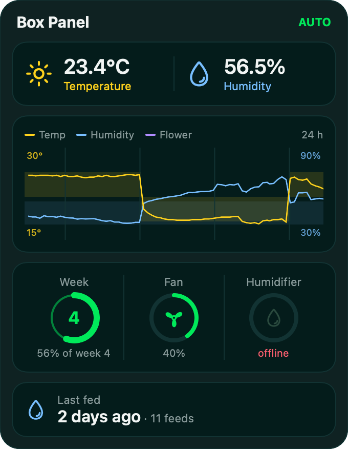
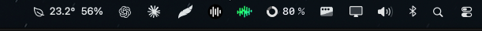

# Growbox macOS widget



Menu bar readout:



A small panel that sits on the desktop and shows the grow box live, like
the home screen of the phone app: temperature and humidity, the last 24 h
chart with target bands and the flowering start, the flowering week, fan
and humidifier, and the last watering (read-only, no button). The menu
bar shows temperature and humidity.

It reads the ESP's HTTP API (`/api/config` every 10 s, `/api/environment`
every 5 min, with a pause between pages - the ESP serves one request at a
time and runs short of RAM with several clients), so it only works in the
home network. Firmware: [firmware](https://github.com/growbox-DIY/firmware),
phone app: [app](https://github.com/growbox-DIY/app), shelf screen:
[external-monitor](https://github.com/growbox-DIY/external-monitor).

## Install with Claude (easiest)

No coding needed: Claude installs the widget for you and explains every
step.

You need:

- a Mac with macOS 14 or newer,
- the [Claude desktop app](https://claude.ai/download) with Claude Code
  (the **Code** tab, included in paid Claude plans),
- the controller's API token, and its address if you know it - ask the
  person who set up the GrowBox controller.

1. Open the Claude app, go to the **Code** tab and choose an empty folder.
2. Paste this and press Enter:

   ```
   Install the GrowBox Mac widget from https://github.com/growbox-DIY/macos-widget for me. Follow the CLAUDE.md in that repo.
   ```

3. Answer Claude's questions and allow what macOS asks for (developer
   tools, local network access).

No Apple account is needed and the widget does not expire. The
step-by-step guide Claude follows is in [CLAUDE.md](CLAUDE.md).

## Setup

Settings are kept outside the repo, in `~/.config/growbox/widget.json`:

```json
{ "url": "http://192.168.18.85", "token": "<API_TOKEN from App/api_token.py>" }
```

## Build and run

```bash
./build.sh install
```

The app is ad-hoc signed for this Mac: no Apple account, it does not
expire. On first start macOS asks for access to the local network - allow
it.

- Drag the panel anywhere; the position is remembered.
- Right-click → Quit.
- Menu bar: the leaf shows temperature and humidity; click hides / shows
  the panel, right-click for the menu.
- Start with the Mac: `./build.sh install` copies the app to
  `~/Applications`; its first start adds it to the login items (toggle:
  right-click → Open at login, or System Settings → General → Login Items).

`GrowBoxWidget --snapshot out.png` renders the panel to a PNG after 10 s
and quits (handy for checking the layout).

Icons are the phone app's Ionicons (`Resources/Ionicons.ttf`, MIT, see
`Resources/Ionicons-LICENSE.txt`).

## License

This project is licensed under [CC BY-NC 4.0](https://creativecommons.org/licenses/by-nc/4.0/):
you may use, share and modify it for non-commercial purposes, with credit to
growbox-DIY. See LICENSE.
